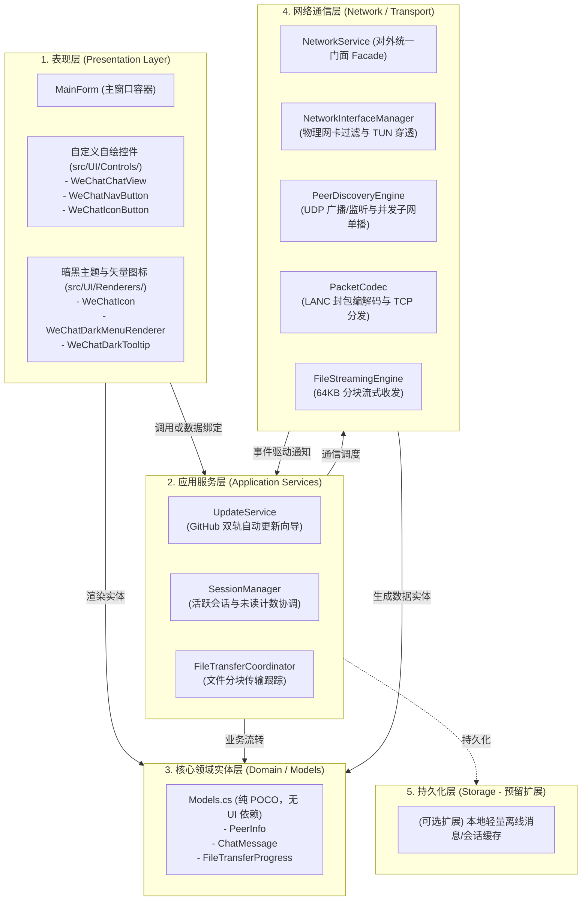

# LanChat 架构解耦与互联网演进重构设计方案

> 文档版本：v1.0.0  
> 编写时间：2026-10-24  
> 适用项目：LanChat（对标微信桌面端暗黑主题的高性能局域网/跨平台即时通讯系统）  
> 关联文件：`src/MainForm.cs`, `src/NetworkService.cs`, `src/Models.cs`, `Tools/Compile.bat`

---

## 一、 现状分析与重构动因

### 1.1 当前代码规模与构成剖析
通过对项目源文件的静态结构与代码行数分析：
* **`src/MainForm.cs`（3,202 行）**：
  * **自绘矢量图标系统（`WeChatIcon`，343 行）**：纯 GDI+ 绘制微信气泡、人像、文件夹、更新箭头等；
  * **自定义自绘控件（共 626 行）**：
    * `WeChatChatView`（366 行）：消息列表自绘、虚拟滚动条、消息气泡排版、文件卡片绘制；
    * `WeChatNavButton`（113 行）：左侧导航栏图标与激活绿条控件；
    * `WeChatIconButton`（84 行）：无边框透明背景图标按钮；
    * `WeChatDarkMenuRenderer` & `WeChatDarkTooltip`（133 行）：暗黑右键菜单与气泡提示渲染器；
  * **在线自动更新引擎（351 行）**：GitHub REST API + Web 302 页面重定向降级探测、更新向导弹窗；
  * **主窗体本身（约 1,880 行）**：混合了 Win32 控件布局、网络事件监听、文件拖拽与发送、Emoji 弹窗、托盘后台驻留与广播唤醒。
* **`src/NetworkService.cs`（1,152 行）**：
  * 同时承担了：①物理网卡过滤与 TUN/VPN 路由穿透；②UDP 广播监听与 254 个 IP 子网单播并发扫描；③点对点 TCP 监听与 LANC 二进制协议编解码；④64KB 分块文件流式传输与背压控制；⑤节点心跳与生命周期管理。

### 1.2 存在的问题与痛点
1. **单一职责原则违背（God Object）**：主窗体充当了全能控制器，任何微小改动（例如调整一个图标的路径或修改更新弹窗）都需要修改 3000 多行的巨型文件。
2. **UI 控件无法复用**：`WeChatChatView`、`WeChatIcon`、`WeChatNavButton` 等高价值自绘组件与主窗体硬编码在同一文件中，难以进行单元测试或独立复用。
3. **服务逻辑侵入界面**：GitHub 在线更新属于独立的应用服务（Application Service），嵌入在 `MainForm.cs` 中导致代码噪点极大。
4. **网络层职责交织**：底层物理网卡绑定、应用层 P2P 协议编解码、文件流传输与内存节点缓存混杂在一起，未来引入新协议（如 WebSocket / TLS）时改动风险高。

---

## 二、 重构核心硬约束（红线原则）

在重构过程中，必须无条件遵守 [Rules.md](file:///c:/Users/mimovr/Desktop/TEmp/Aritex/LanChat/.claude/Rules.md) 中的工程契约：

1. **以最小实现、零冗余依赖为荣**：
   * 严禁随意引入重量级第三方 NuGet 包。
   * Windows 端必须保持使用系统自带原生 `csc.exe`（`Framework64\v4.0.30319`）极速秒级编译，可执行文件控制在数十 KB 级别，免任何运行库安装。
2. **语法兼容性约束（C# 5.0 / .NET Framework 4.0）**：
   * 编译环境基于老版本 `csc.exe`，严禁使用 C# 8.0+ 的语法（如可空引用类型标注 `?`、模式匹配增强、记录类型 `record` 等），确保在纯净 Windows 7/10/11 上均能一次性编译通过。
3. **跨平台双端共享兼容**：
   * Linux 终端版本（`src/linux/LanChat.Linux/LanChat.Linux.csproj`）直接通过软链接引用 `..\Models.cs` 与 `..\NetworkService.cs`。
   * 重构网络层时，对外暴露的 `NetworkService` 接口和公开事件必须保持 100% 向后兼容，严禁导致 Linux 终端端构建断裂。
4. **全中文注释与二进制协议稳定**：
   * 底层网络魔数 `0x4C, 0x41, 0x4E, 0x43`（`"LANC"`）、LEB128 变长前缀 UTF-8 编码、64KB 分块流式协议保持向后兼容。
   * 所有新增/重构的代码、类与方法均配备清晰全中文注释。

---

## 三、 专业即时通讯（IM）系统解耦架构设计

针对现代即时通讯桌面客户端，标准工程架构分为 5 个清晰层次：



### 各层职责规范：
1. **表现层（UI）**：纯界面渲染与用户输入捕获。不直接调用任何底层的 Socket 或网络流，仅通过应用服务层暴露的事件和方法进行数据绑定。
2. **应用服务层（Services）**：充当界面与网络层的中介桥梁，处理会话切换、未读小红点计算、版本更新检测。
3. **核心领域实体（Models）**：纯 C# 对象，不包含任何 System.Windows.Forms 依赖，实现 Windows 和 Linux 跨端源码级共享。
4. **网络通信层（Network）**：纯底层传输与路由。负责套接字创建、多物理网卡绑定、TUN 冲突消除、高并发单播探测与流式分块。通过标准 C# `event` 向外派发数据。

---

## 四、 局域网 P2P 走向互联网（Internet IM）的演进路线

从“局域网点对点”跨越到“互联网在线聊天”，需克服 5 项关键架构鸿沟：

| 维度 | 局域网 P2P（当前状态） | 互联网 IM 演进（目标架构） | 核心技术方案 |
| :--- | :--- | :--- | :--- |
| **连通性** | 同一子网内，直接连接目标私网 IP (`192.168.x.x`) | 双方均位于运营商级 NAT 之后，无公网 IP，直连必定失败 | **方案 A (P2P)**：STUN + TURN + ICE 打洞与中继；<br>**方案 B (行业标准)**：长连接接入网关（IM Gateway），全走服务端中转。 |
| **寻址与发现** | UDP 局域网广播 (`255.255.255.255`) 及全子网 IP 扫描 | 互联网路由器丢弃广播报文，无法广播发现 | 集中式账号系统 + 服务注册中心，用户登录后上报网关，通过 UID 寻址。 |
| **消息可靠性** | 必须双方同时在线，接收方离线直接丢弃 | 离线消息暂存、跨设备多端漫游、网络抖动重连补偿 | 服务端离线消息库（Store-and-Forward）+ 会话严格单调递增序号（`MsgSeq` / `SyncKey` 增量同步）。 |
| **富媒体与文件** | 双方建立 TCP 套接字，按 64KB 块流式直发（100+ MB/s） | 客户端上行带宽受限，直发极易因网络抖动中断 | 对象存储（MinIO / OSS / S3）+ 预签名 URL 直传 + CDN 边缘加速 + 分块断点续传。 |
| **通信安全** | 明文通信（基于信任的局域网安全边界） | 公网存在窃听、中间人劫持与篡改风险 | 传输层启用 TLS 1.3 加密通道；核心隐私消息引入端到端加密（E2EE，如 Signal 双棘轮算法）。 |

---

## 五、 渐进式重构落地方案

为确保重构过程**绝对不引入 Bug、不中断功能、保持原生秒级编译**，将重构划分为三步：

### 第一阶段（Phase 1）：UI 控件、矢量图系统与更新服务物理剥离（立减 1,400+ 行）
* **目标**：将 `MainForm.cs` 中所有独立的 UI 控件、绘图引擎和更新逻辑搬入专属目录，使 `MainForm.cs` 瘦身至 1,400 行左右。
* **物理文件切分规划**：
  1. `src/UI/Renderers/WeChatIcon.cs`：
     * 包含 `WeChatIconType` 枚举与 `WeChatIcon` GDI+ 路径自绘算法（~345 行）；
  2. `src/UI/Renderers/WeChatDarkMenuRenderer.cs`：
     * 包含 `WeChatDarkMenuColorTable`、`WeChatDarkMenuRenderer` 与 `WeChatDarkTooltip`（~135 行）；
  3. `src/UI/Controls/WeChatChatView.cs`：
     * 包含 `WeChatChatView` 自绘消息流视图与 `MessageRenderItem` 测量排版逻辑（~370 行）；
  4. `src/UI/Controls/WeChatButtons.cs`：
     * 包含 `WeChatNavButton` 与 `WeChatIconButton`（~200 行）；
  5. `src/Services/UpdateService.cs`：
     * 包含 GitHub REST API 请求、Web 302 重定向降级解析与暗黑更新向导弹窗（~350 行）。
* **配套工具链升级**：
  * 更新 `Tools/Compile.bat` 与 `Tools/CompileAndLink.bat`，自动编译新增子目录中的 `.cs` 源文件：
    ```cmd
    "%CSC_PATH%" /nologo /target:winexe /win32icon:assets\app.ico /r:System.Windows.Forms.dll,System.Drawing.dll,System.dll,System.Core.dll /out:release\LanChat.exe src\*.cs src\UI\Controls\*.cs src\UI\Renderers\*.cs src\Services\*.cs
    ```
  * 同步更新 `src/LanChat.csproj`，确保 Visual Studio / Rider 正常识别。
  * 实机调用 `csc.exe` 进行纯编译与覆盖测试，验证零报错、零白边、无功能退化。

### 第二阶段（Phase 2）：主窗体职责模块化（Partial Class）
* **目标**：将 `MainForm.cs` 内部复杂的业务逻辑按领域划分为 Partial 类，将主文件彻底精简至 300~400 行的核心骨架。
* **文件拆分规划**：
  * `src/MainForm.cs`：窗体核心构造、控件布局树、系统 DPI 与整体生命周期；
  * `src/MainForm.Chat.cs`：会话切换、文本发送、Emoji 选择器交互；
  * `src/MainForm.Files.cs`：文件/文件夹拖拽、进度条渲染与传输任务回调；
  * `src/MainForm.Tray.cs`：系统托盘右键菜单、最小化后台驻留与全局广播唤醒。

### 第三阶段（Phase 3）：网络层轻量门面解耦（Linux 跨端零破坏）
* **目标**：在不改变 `NetworkService` 现有公开 API 与事件的前提下，对底层进行职责分离。
* **方案**：
  * 保持 `NetworkService` 作为顶层外观（Facade），供 `MainForm` 和 `LanChat.Linux` 零成本调用；
  * 提取子模块：
    * `src/Network/NetworkInterfaceManager.cs`：物理网卡与 TUN 冲突消除；
    * `src/Network/PeerDiscoveryEngine.cs`：UDP 广播与子网扫描；
    * `src/Network/FileStreamingEngine.cs`：64KB 流式分块传输。
  * 同步更新 `LanChat.Linux.csproj`，保证 Linux 终端版顺利编译。

---

## 六、 质量验收与回归标准

重构每一步必须通过以下严格验收标准：
1. **编译测试**：调用 `Tools/Compile.bat`，原生 `csc.exe` 耗时 < 1 秒，0 警告，0 错误；
2. **体积控制**：生成的 `release/LanChat.exe` 体积稳定在 140KB 左右（绝不产生额外 runtime 膨胀）；
3. **视觉与交互回归**：
   * 微信暗黑主题色值一致，无任何控件出现 Win32 原生白色残留；
   * 消息列表滚动流畅，窗体最小化不触发滚动条越界异常；
   * 单实例互斥与托盘唤醒机制工作正常；
4. **网络与文件回归**：
   * 节点发现与自动上线正常；
   * 局域网文本消息往返延迟 < 10ms；
   * 大文件传输保持 64KB 分块与千兆满速流式收发；
   * 在线更新检查正常呼出暗黑引导窗口。
